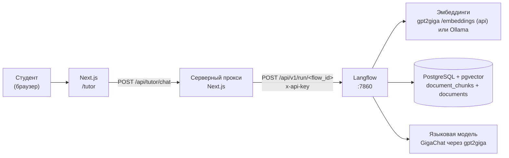
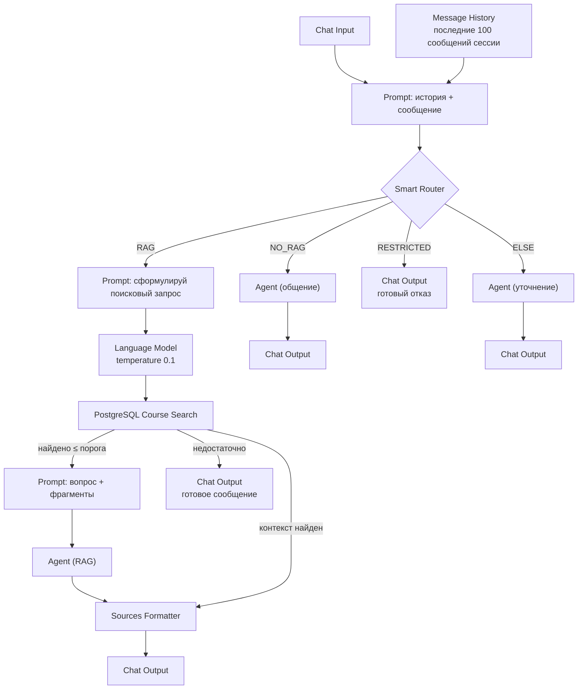

# Tutor — ИИ-помощник по курсу «Устойчивое развитие: системный подход»

Tutor помогает студенту разбираться в материалах курса и условиях заданий, искать материалы и планировать самостоятельную работу.

> [!IMPORTANT]
> Tutor **не** выполняет задания за студента, **не** пишет готовые работы для сдачи, **не** выставляет оценки и **не** решает вопрос о допуске к защите. Это ограничение зашито в маршрутизацию и в системные промпты Flow — не ослабляйте его при правках.

**Ветка `tutor`** содержит две части, которые работают вместе:

| Часть                | Что это                                                                     | Где описана                                        |
| -------------------- | --------------------------------------------------------------------------- | -------------------------------------------------- |
| **Backend-прототип** | Langflow-поток (Flow) с поиском по материалам курса в PostgreSQL + pgvector | этот файл                                          |
| **Веб-интерфейс**    | Чат на Next.js, который общается с Flow через Langflow API                  | [`docs/TUTOR_FRONTEND.md`](docs/TUTOR_FRONTEND.md) |

---

## Содержание

- [Как это работает](#как-это-работает)
- [Текущий статус](#текущий-статус)
- [Структура репозитория](#структура-репозитория)
- [Быстрый старт](#быстрый-старт)
- [Требования](#требования)
- [Настройка окружения](#настройка-окружения)
- [Языковая модель и gpt2giga](#языковая-модель-и-gpt2giga)
- [Запуск Langflow](#запуск-langflow)
- [Импорт Flow](#импорт-flow)
- [Первичная проверка](#первичная-проверка)
- [Устройство Flow](#устройство-flow)
- [Известные ограничения](#известные-ограничения)
- [Если нужно изменить Flow или компоненты](#если-нужно-изменить-flow-или-компоненты)

---

## Как это работает



- Браузер **никогда** не обращается к Langflow напрямую: ключ API хранится только на сервере Next.js.
- Внутри Langflow сообщение сначала попадает в **Smart Router**, который выбирает один из маршрутов (подробнее — в разделе [«Устройство Flow»](#устройство-flow)):

```
Сообщение + история
        ↓
   Smart Router
        ├─ RAG        → поисковый запрос → PostgreSQL → Agent → проверка источников
        ├─ NO_RAG     → общение или уточнение без поиска
        ├─ RESTRICTED → готовый отказ
        └─ ELSE       → просьба уточнить запрос
```

`ELSE` — штатный выход Smart Router: он срабатывает, когда модель-маршрутизатор вернула результат, не совпадающий с именем ни одного из настроенных маршрутов.

Все содержательные учебные запросы объединены в одну цепочку `RAG`.

---

## Текущий статус

Это **локальный прототип** до интеграции с общим backend и Telegram.

| Готово                                                           | Не подтверждено / не сделано                                                                                     |
| ---------------------------------------------------------------- | ---------------------------------------------------------------------------------------------------------------- |
| Маршрутизация запросов с учётом истории                          | Работа на Windows и других устройствах                                                                           |
| Поиск фрагментов в PostgreSQL с pgvector                         | Работа в общей инфраструктуре                                                                                    |
| Ответ модели на основе найденных фрагментов                      | Калибровка порога на новой базе курса                                                                            |
| Выбор провайдера эмбеддингов: `api` (по ключу) или `ollama`      | Режим эмбеддингов `api` (gpt2giga `/embeddings`) на живом стенде                                                 |
| Отдельный отказ для запрещённых запросов                         | Заполнение страниц учебника в `TEXTBOOK_PAGES` (нужен PDF, см. [docs/TEXTBOOK_LINKS.md](docs/TEXTBOOK_LINKS.md)) |
| Вывод источников с названиями документов (`documents.filename`)  | Серверное хранение истории чатов во фронтенде                                                                    |
| Веб-чат на Next.js (несколько чатов, markdown, обработка ошибок) | Авторизация пользователей                                                                                        |

Основные маршруты, ветки поиска, история и экспорт/импорт Flow проверены в локальной среде. Экспорт и импорт проверялись на том же устройстве.

> [!NOTE]
> Компоненты рассчитаны на схему базы `sustainability_course_db` из ветки `database` (таблицы `documents` и `document_chunks`). Как заменить старую тестовую БД на неё — в [`docs/DATABASE_REPLACEMENT.md`](docs/DATABASE_REPLACEMENT.md).

### Что проверялось при подготовке этой документации

| Проверка                                                        | Результат                                                                                                                                                                                        |
| --------------------------------------------------------------- | ------------------------------------------------------------------------------------------------------------------------------------------------------------------------------------------------ |
| `npm run build`                                                 | ✅ проходит                                                                                                                                                                                      |
| `tsc --noEmit`                                                  | ✅ без ошибок                                                                                                                                                                                    |
| `npm run lint`                                                  | ⚠️ 2 ошибки `react-hooks/purity` (`Date.now()` в `TutorChat.tsx`, строки ~270 и ~314) и 1 предупреждение (лишний `eslint-disable` в `Composer.tsx`). На работу не влияет, но `lint` не «зелёный» |
| API-роуты `/api/health`, `/api/tutor/status`, `/api/tutor/chat` | ✅ проверены против имитации Langflow: ответ извлекается, `USED_SOURCES` вырезается, ошибки валидации возвращают 400                                                                             |
| `bash -n tutor-local.sh`, компиляция Python-компонентов         | ✅ синтаксис корректен (для версии скрипта с режимами эмбеддингов — ⏳ проверить после правок)                                                                                                   |
| Секреты в `flow/tutor-flow.json`                                | ✅ значения `api_key` пусты, ключей и паролей нет                                                                                                                                                |
| Образ `langflowai/langflow:1.13.0`                              | ✅ тег существует на Docker Hub                                                                                                                                                                  |
| Запуск Langflow, Ollama, gpt2giga, реальной БД                  | ⏳ в рамках проверки документации не запускались                                                                                                                                                 |

---

## Структура репозитория

```
.
├── README.md                      ← вы здесь
├── docs/
│   ├── TUTOR_FRONTEND.md          документация по веб-интерфейсу
│   └── DATABASE_REPLACEMENT.md    как заменить тестовую БД на sustainability_course_db
│
├── ── Langflow (backend-прототип) ──
├── flow/
│   └── tutor-flow.json            экспорт Flow для импорта в Langflow
├── custom_components/
│   ├── postgres_course_search.py  эмбеддинг запроса, поиск фрагментов и выбор ветки по cosine distance
│   └── sources_formatter.py       проверка ID фрагментов и вывод документов-источников
├── docker-compose.yml             Langflow + его служебная БД
├── docker-compose.tutor.yml       надстройка Tutor: свой образ, .env, подключение компонентов
├── Dockerfile.tutor               базовый образ Langflow для Tutor
├── tutor-local.sh                 запуск/остановка и проверки (Linux, Bash)
│
├── ── Фронтенд (Next.js 16, React 19, Tailwind 4) ──
├── src/
│   ├── app/
│   │   ├── page.tsx               редирект / → /tutor
│   │   ├── tutor/page.tsx         страница чата
│   │   └── api/
│   │       ├── health/route.ts    проверка живости самого Next.js
│   │       └── tutor/
│   │           ├── chat/route.ts    прокси к Langflow
│   │           └── status/route.ts  проверка Langflow и настроек
│   ├── components/tutor/          UI-компоненты чата
│   └── lib/tutor/                 типы, ошибки, клиент Langflow, хранилище чатов
├── package.json, tsconfig.json, next.config.ts, eslint.config.mjs, postcss.config.mjs
│
├── ── Шаблонные остатки (Tutor их не использует) ──
├── src/db/, drizzle.config.json   заготовка Drizzle/PostgreSQL из шаблона проекта
│
├── .env.example                   единый шаблон настроек → скопировать в .env
└── .gitignore
```

### Назначение ключевых файлов

| Файл                                          | Назначение                                                                                                                                                                            |
| --------------------------------------------- | ------------------------------------------------------------------------------------------------------------------------------------------------------------------------------------- |
| `.env.example`                                | Шаблон **единого** файла настроек: его читают фронтенд, Docker Compose и `tutor-local.sh`                                                                                             |
| `flow/tutor-flow.json`                        | Экспорт Flow `tutor-rag-v2` (17 узлов), последний тест — Langflow 1.13.0                                                                                                              |
| `custom_components/postgres_course_search.py` | Эмбеддинг запроса (провайдер из `.env` или из узла) → поиск в `public.document_chunks` (+ `public.documents` для названий) → два выхода: «контекст найден» и «контекста недостаточно» |
| `custom_components/sources_formatter.py`      | Сверяет `USED_SOURCES` из ответа модели с реально найденными фрагментами и добавляет блок «Источники» с названиями документов                                                         |
| `docker-compose.yml`                          | Langflow (порт только на `127.0.0.1:7860`) и его собственная PostgreSQL                                                                                                               |
| `docker-compose.tutor.yml`                    | Собирает образ `tutor-langflow:local`, передаёт в контейнер `.env`, монтирует `custom_components` (read-only)                                                                         |
| `Dockerfile.tutor`                            | Сейчас — одна строка `FROM langflowai/langflow:latest` (см. [версия Langflow](#версия-langflow))                                                                                      |
| `tutor-local.sh`                              | `start` / `stop`: запуск Compose, проверка эмбеддингов (Ollama или API) и PostgreSQL изнутри контейнера Langflow                                                                      |

> [!NOTE]
> Раньше настройки лежали в `.env.tutor` (шаблон `.env.tutor.example`). **Теперь шаблон — `.env.example`, а рабочий файл — `.env`.** Старый `.env.tutor` всё ещё подхватывается как запасной вариант (если `.env` нет), но для новых установок он не нужен.

---

## Быстрый старт

Полный путь «с нуля» до работающего чата. Каждый шаг подробно описан ниже.

```bash
# 1. Единый файл настроек
cp .env.example .env                 # Windows PowerShell: Copy-Item .env.example .env
#    заполните: LANGFLOW_SUPERUSER_PASSWORD, TUTOR_DB_*,
#    и эмбеддинги: TUTOR_EMBEDDINGS_* (режим api) или OLLAMA_* (режим ollama)
#    (LANGFLOW_API_KEY и TUTOR_FLOW_ID заполните на шаге 4)

# 2. Подготовьте вне репозитория: PostgreSQL с pgvector, эмбеддинги
#    (OpenAI-совместимый /embeddings по ключу либо Ollama с bge-m3), gpt2giga

# 3. Запустите Langflow
chmod +x tutor-local.sh && ./tutor-local.sh start
#    Windows/вручную: docker compose -f docker-compose.yml -f docker-compose.tutor.yml up -d --build

# 4. В Langflow (http://127.0.0.1:7860):
#    а) импортируйте flow/tutor-flow.json, настройте модели
#    б) ID потока из адреса .../flow/<ID>  → TUTOR_FLOW_ID в .env
#    в) Settings → Langflow API Keys → Create → LANGFLOW_API_KEY в .env

# 5. Запустите фронтенд
npm install
npm run dev                          # http://localhost:3000
```

Индикатор в правом верхнем углу чата должен показать **«Tutor онлайн»**. Дальше — [первичная проверка](#первичная-проверка).

---

## Требования

### Обязательные

- **Docker** и **Docker Compose v2.24+** (в `docker-compose.tutor.yml` используется `env_file` с `required: false`).
- **Node.js 20.9+** для фронтенда (проверялось на Node 22).
- **PostgreSQL с расширением pgvector** и таблицами `public.document_chunks` и `public.documents` (схема — в [`docs/DATABASE_REPLACEMENT.md`](docs/DATABASE_REPLACEMENT.md)).
- Пользователь PostgreSQL с правами на чтение нужных данных.
- **Доступ к эмбеддингам** — одно из двух:
  - OpenAI-совместимый `/embeddings` по API-ключу (например, `gpt2giga` с моделью `EmbeddingsGigaR`);
  - **или** Ollama с embedding-моделью.

  В обоих случаях модель должна давать векторы размерности **1024** и той же векторной модели, что и в базе.

- Доступная **языковая модель** для Router и ответов Tutor.
- Файл `flow/tutor-flow.json` (есть в репозитории).

### Проверенная локальная конфигурация

- Langflow **1.13.0**.
- Эмбеддинги через Ollama с моделью `bge-m3:latest` (режим `ollama`).
- Векторы размерности **1024** в PostgreSQL.
- GigaChat (`GigaChat-2-Max`) через отдельный OpenAI-compatible прокси `gpt2giga`.
- Режим `api` (эмбеддинги через `gpt2giga` с `EmbeddingsGigaR`) — в разработке, на стенде не проверялся.

> [!WARNING]
> Совпадения размерности векторов недостаточно: модель, которой кодируются поисковые запросы, должна быть той же (или совместимой), которой создавались векторы в базе.

### Версия Langflow

В `Dockerfile.tutor` указано:

```dockerfile
FROM langflowai/langflow:latest
```

Тег `latest` не фиксирует версию: на другом устройстве или через месяц может загрузиться более новая версия Langflow, несовместимая с Flow или компонентами. Прототип проверялся с **1.13.0**; тег `langflowai/langflow:1.13.0` существует на Docker Hub.

**Рекомендация:** заменить строку на `FROM langflowai/langflow:1.13.0`, пересобрать образ (`docker compose ... up -d --build`) и проверить Flow. Для общей инфраструктуры версию нужно согласовать с командой.

> [!NOTE]
> Поле `image: langflowai/langflow:latest` в `docker-compose.yml` на запуск не влияет: `docker-compose.tutor.yml` заменяет его на образ `tutor-langflow:local`, собранный из `Dockerfile.tutor`. Версию нужно менять именно в Dockerfile.

---

## Настройка окружения

### 1. Подготовьте базу материалов

Нужна PostgreSQL с pgvector, **доступная из контейнера Langflow**. Компонент поиска обращается к таблицам `public.document_chunks` и `public.documents` (связь `document_chunks.document_id → documents.id`) и использует поля:

| Поле                 | Назначение                                                                                                                                  |
| -------------------- | ------------------------------------------------------------------------------------------------------------------------------------------- |
| `id`                 | ID фрагмента (`chunk_id` в источниках)                                                                                                      |
| `document_id`        | ID документа (связь с `documents.id`, пара `document_id:chunk_id` в источниках)                                                             |
| `content`            | Текст фрагмента                                                                                                                             |
| `documents.filename` | Имя файла документа — из него строится название в блоке «Источники» (расширение `.txt` скрывается). Если имени нет, выводится «Документ №N» |
| `embedding`          | Вектор размерности **1024** (задана константой `VECTOR_DIMENSION` в компоненте)                                                             |

Используйте учётную запись **только на чтение** (достаточно `SELECT` на обе таблицы). Скрипт запуска не создаёт базу и не восстанавливает дамп — как это сделать, описано в [`docs/DATABASE_REPLACEMENT.md`](docs/DATABASE_REPLACEMENT.md). Компонент выполняет запросы в `READ ONLY`-транзакции.

> [!CAUTION]
> Не подключайте Tutor к общей проектной БД без согласования с командой.

### 2. Создайте `.env` — единый файл настроек

```bash
# Linux / macOS
cp .env.example .env
```

```powershell
# Windows PowerShell
Copy-Item .env.example .env
```

Этот **один** файл читают три потребителя:

| Потребитель        | Что берёт                                                                                                                  |
| ------------------ | -------------------------------------------------------------------------------------------------------------------------- |
| Фронтенд (Next.js) | `LANGFLOW_*`, `TUTOR_FLOW_ID`, `TUTOR_INPUT_MODE`, `TUTOR_REQUEST_TIMEOUT_MS`, `TUTOR_DEBUG`, `NEXT_PUBLIC_COURSE_NAME`    |
| Docker Compose     | `LANGFLOW_SUPERUSER_PASSWORD` (подстановка в `docker-compose.yml`) и весь файл целиком — как окружение контейнера Langflow |
| `tutor-local.sh`   | `TUTOR_DB_*`, `TUTOR_EMBEDDINGS_*` или `OLLAMA_*` (по режиму), `TUTOR_COMPOSE_*`, `TUTOR_STOP_*`                           |

#### Справочник переменных

**Фронтенд**

| Переменная                 | Обяз. | По умолчанию                            | Назначение                                                                                                                 |
| -------------------------- | :---: | --------------------------------------- | -------------------------------------------------------------------------------------------------------------------------- |
| `LANGFLOW_URL`             |   —   | `http://127.0.0.1:7860`                 | Адрес Langflow **с машины, где запущен Next.js**. Если фронтенд тоже в Docker — `http://langflow:7860`                     |
| `LANGFLOW_API_KEY`         |  да   | —                                       | Ключ из Langflow → _Settings → Langflow API Keys_. Только на сервере, в браузер не попадает                                |
| `TUTOR_FLOW_ID`            |  да   | —                                       | ID потока из адреса `.../flow/<ID>` (можно указать и endpoint name). **Меняется при каждом новом импорте Flow**            |
| `TUTOR_INPUT_MODE`         |   —   | `text`                                  | `text` — обычный чат (поток из этой ветки); `json` — формат guarded-flow из ветки `main` (Telegram)                        |
| `TUTOR_REQUEST_TIMEOUT_MS` |   —   | `120000`                                | Сколько ждать ответа Langflow. Значения меньше `5000` игнорируются                                                         |
| `TUTOR_DEBUG`              |   —   | `0`                                     | `1` — показывать «Технические детали» в уведомлениях об ошибках. Только для отладки                                        |
| `NEXT_PUBLIC_COURSE_NAME`  |   —   | «Устойчивое развитие: системный подход» | Название курса в заголовке и приветствии. **Вшивается при сборке** — для `npm start` после изменения нужен `npm run build` |

> Значения-заглушки вида `YOUR_...` фронтенд считает «не заданными».

**Langflow (`docker-compose.yml`)**

| Переменная                    | Обяз. | Назначение                                                                                                                                          |
| ----------------------------- | :---: | --------------------------------------------------------------------------------------------------------------------------------------------------- |
| `LANGFLOW_SUPERUSER_PASSWORD` |  да   | Пароль суперпользователя Langflow. Без него `docker compose` не запустится. Логин — `langflow` (значение по умолчанию), если Langflow попросит вход |

**Инфраструктура Tutor (`tutor-local.sh`, компоненты Flow)**

| Переменная                         | Обяз. | По умолчанию | Назначение                                                                                                             |
| ---------------------------------- | :---: | ------------ | ---------------------------------------------------------------------------------------------------------------------- |
| `TUTOR_DB_CONTAINER`               |   —   | пусто        | Имя существующего Docker-контейнера БД, чтобы скрипт мог его запускать и подключать к сети Langflow. Может быть пустым |
| `TUTOR_DB_HOST`                    |  да   | —            | Адрес PostgreSQL **из контейнера Langflow** (он может отличаться от адреса на хосте)                                   |
| `TUTOR_DB_PORT`                    |   —   | `5432`       | Порт PostgreSQL                                                                                                        |
| `TUTOR_DB_NAME`                    |  да   | —            | Имя базы материалов                                                                                                    |
| `TUTOR_DB_USER`                    |  да   | —            | Пользователь БД (только чтение)                                                                                        |
| `TUTOR_DB_PASSWORD_B64`            |  да   | —            | Пароль в Base64: `printf '%s' 'мой_пароль' \| base64`. Base64 — не шифрование, храните как обычный пароль              |
| `TUTOR_DB_CONNECT_TIMEOUT_SECONDS` |   —   | `10`         | Тайм-аут подключения к БД                                                                                              |
| `TUTOR_DB_STATEMENT_TIMEOUT_MS`    |   —   | `30000`      | Тайм-аут SQL-запроса                                                                                                   |

**Эмбеддинги: переключатель режима**

| Переменная                  | Обяз. | По умолчанию   | Назначение                                                                                                                       |
| --------------------------- | :---: | -------------- | -------------------------------------------------------------------------------------------------------------------------------- |
| `TUTOR_EMBEDDINGS_PROVIDER` |   —   | см. назначение | `api` или `ollama`. Если пусто: `api`, когда задан `TUTOR_EMBEDDINGS_BASE_URL`, иначе `ollama` (совместимость со старыми `.env`) |

**Режим `api`** (OpenAI-совместимый `/embeddings`, Ollama не нужна)

| Переменная                       |   Обяз.   | По умолчанию | Назначение                                                                                                                                                                                 |
| -------------------------------- | :-------: | ------------ | ------------------------------------------------------------------------------------------------------------------------------------------------------------------------------------------ |
| `TUTOR_EMBEDDINGS_BASE_URL`      | при `api` | —            | Базовый адрес сервера эмбеддингов **без** `/embeddings`, например `http://host.docker.internal:8080/v1`                                                                                    |
| `TUTOR_EMBEDDINGS_MODEL`         | при `api` | —            | Модель этого сервера, например `EmbeddingsGigaR` (у `gpt2giga` по умолчанию)                                                                                                               |
| `TUTOR_EMBEDDINGS_API_KEY`       |     —     | пусто        | Литеральный ключ **или** имя переменной окружения (например `OPENAI_API_KEY`), которое разрешит Langflow. Пусто — если сервер без авторизации или ключ задан в Langflow (Global Variables) |
| `TUTOR_EMBEDDINGS_PROVIDER_NAME` |     —     | пусто        | Провайдер внутри Langflow. Пусто: в режиме `api` — `OpenAI`, в режиме `ollama` — берётся из узла Flow (`Ollama`). Не задавайте `OpenAI` при режиме `ollama`                                |
| `TUTOR_EMBEDDINGS_DIMENSIONS`    |     —     | пусто        | Передавать ли `dimensions` в запрос (нужно для `text-embedding-3-*`). Пусто — не передавать. Итоговая размерность обязана быть **1024**                                                    |

**Режим `ollama`**

| Переменная               |    Обяз.     | По умолчанию | Назначение                                                                                           |
| ------------------------ | :----------: | ------------ | ---------------------------------------------------------------------------------------------------- |
| `OLLAMA_BASE_URL`        | при `ollama` | —            | Адрес Ollama из контейнера, обычно `http://host.docker.internal:11434`                               |
| `OLLAMA_EMBEDDING_MODEL` | при `ollama` | —            | Модель, наличие которой проверяет скрипт (`bge-m3:latest`)                                           |
| `TUTOR_OLLAMA_SERVICE`   |      —       | пусто        | Имя системного сервиса Ollama (Linux) для запуска/остановки скриптом. В режиме `api` не используется |

**Остановка и сеть**

| Переменная                          | Обяз. | По умолчанию       | Назначение                                                                    |
| ----------------------------------- | :---: | ------------------ | ----------------------------------------------------------------------------- |
| `TUTOR_COMPOSE_PROJECT`             |   —   | имя каталога       | Имя Compose-проекта (`[a-z0-9_-]`, начинается с буквы/цифры)                  |
| `TUTOR_STOP_DB_ON_STOP`             |   —   | `0`                | `1` — `stop` дополнительно остановит контейнер БД                             |
| `TUTOR_STOP_OLLAMA_SERVICE_ON_STOP` |   —   | `0`                | `1` — `stop` дополнительно остановит сервис Ollama (только в режиме `ollama`) |
| `TUTOR_COMPOSE_NETWORK`             |   —   | `<проект>_default` | Запасное имя Docker-сети при остановке                                        |

> [!IMPORTANT]
> **Правила формата `.env`.** `tutor-local.sh` не выполняет файл как shell-скрипт, а разбирает простые строки `KEY=value`. Не используйте `export`, команды, подстановки `$(...)`, кавычки вокруг значений. Пробелы по краям значения скрипт обрезает, но лучше их не ставить.

> [!CAUTION]
>
> - **Не добавляйте `.env` и `.env.tutor` в Git** (они уже в `.gitignore`).
> - Весь `.env` передаётся в контейнер Langflow целиком (`env_file`), включая `LANGFLOW_API_KEY`, `TUTOR_EMBEDDINGS_API_KEY` и пароли. Это нормально для локального запуска, но не публикуйте контейнер и его `docker inspect`.
> - `tutor-local.sh` при запуске выполняет `chmod 600` для файла настроек.

### 3. Подготовьте эмбеддинги

Выберите один из двух режимов. Режим задаётся `TUTOR_EMBEDDINGS_PROVIDER` в `.env`.

#### Режим `api` — через OpenAI-совместимый `/embeddings`

Подходит, если уже есть прокси с API-ключом (например, `gpt2giga`). Ollama в этом режиме **не нужна**.

```
TUTOR_EMBEDDINGS_PROVIDER=api
TUTOR_EMBEDDINGS_BASE_URL=http://host.docker.internal:8080/v1
TUTOR_EMBEDDINGS_MODEL=EmbeddingsGigaR
TUTOR_EMBEDDINGS_API_KEY=
```

Проверьте сервер эмбеддингов с хоста (ответ должен содержать вектор длиной **1024**):

```bash
curl -s "$TUTOR_EMBEDDINGS_BASE_URL/embeddings" \
  -H "Authorization: Bearer $TUTOR_EMBEDDINGS_API_KEY" \
  -H "Content-Type: application/json" \
  -d '{"model":"EmbeddingsGigaR","input":"проверка"}' \
  | python3 -c "import sys,json; print(len(json.load(sys.stdin)['data'][0]['embedding']))"
```

Если размерность не 1024, в `.env` можно задать `TUTOR_EMBEDDINGS_DIMENSIONS` (для моделей, которые это поддерживают), либо модель не подходит для существующей базы.

#### Режим `ollama` — локальная Ollama

Установите и запустите Ollama на хосте и скачайте модель:

```bash
ollama pull bge-m3:latest
```

В `.env`:

```
TUTOR_EMBEDDINGS_PROVIDER=ollama
OLLAMA_BASE_URL=http://host.docker.internal:11434
OLLAMA_EMBEDDING_MODEL=bge-m3:latest
```

Адрес и доступность зависят от ОС и конфигурации Docker. Проверьте, что Ollama доступна именно **из контейнера Langflow**, а не только из браузера или терминала хоста.

> [!WARNING]
> Не заменяйте embedding-модель другой только потому, что совпала размерность: для существующих векторов нужна совместимая модель. Переход с одного режима на другой **не меняет** векторы в базе — см. [«Известные ограничения»](#известные-ограничения).

---

## Языковая модель и gpt2giga

В локальной проверке Tutor использовал GigaChat (`GigaChat-2-Max`) через `gpt2giga` — OpenAI-compatible прокси. В Flow модель выбрана как провайдер «OpenAI Compatible».

> [!IMPORTANT]
> **`tutor-local.sh` не устанавливает, не запускает, не останавливает и не проверяет `gpt2giga`.** Прокси нужно подготовить отдельно, **до** использования моделей в Flow. Сообщение скрипта «Tutor запущен» не подтверждает доступность прокси.

### Установка в отдельное Python-окружение

Нужны Python и `uv`. Выполняйте команды в отдельном каталоге, где можно создать виртуальное окружение.

**Linux / macOS:**

```bash
uv venv
uv pip install --python .venv/bin/python gpt2giga
.venv/bin/gpt2giga --help
```

**Windows PowerShell:**

```powershell
uv venv
uv pip install --python .venv\Scripts\python.exe gpt2giga
.\.venv\Scripts\gpt2giga.exe --help
```

`--help` показывает установленную версию и доступные параметры — они могут различаться между версиями.

### Настройка и запуск прокси

1. Настройте учётные данные GigaChat локально согласно документации установленной версии `gpt2giga`.
2. При необходимости настройте доверенный сертификат Минцифры по официальной инструкции GigaChat. **Не отключайте проверку TLS** для постоянной работы.
3. Запустите прокси и проверьте, что он доступен **из контейнера Langflow**.
4. Укажите в Langflow адрес OpenAI-compatible API, например `http://host.docker.internal:8090/v1`. Это пример: фактический адрес и порт зависят от запуска прокси. В экспортированном Flow адрес и ключ **пустые** — их нужно задать после импорта (в самих компонентах или в настройках провайдера Langflow — зависит от интерфейса версии).
5. Если прокси слушает только `127.0.0.1` на хосте, контейнеру он может быть недоступен — настройте прослушивание и сетевой доступ под вашу ОС и Docker.

### Эмбеддинги через тот же прокси

Если `gpt2giga` в вашей версии поддерживает эмбеддинги, тот же прокси и тот же ключ можно использовать для режима `api` (см. [«Режим api»](#режим-api--через-openai-совместимый-embeddings)). Эндпоинт и модель по умолчанию зависят от версии и флагов запуска (в документации `gpt2giga` — `--proxy.embeddings`, по умолчанию `EmbeddingsGigaR`). Сверьтесь с `--help` и проверьте ответ curl-командой из раздела выше. Если прокси эмбеддингов не отдаёт, выберите другой OpenAI-совместимый сервер или режим `ollama`.

> [!CAUTION]
>
> - Не открывайте прокси в сеть без необходимости; если он доступен за пределами хоста — настройте авторизацию и ограничьте доступ. HTTP сам по себе не шифрует данные.
> - Не помещайте ключи и токены в репозиторий и документацию.
> - Перед отправкой реальных сообщений студентов и материалов во внешний GigaChat **согласуйте конфиденциальность данных**.

---

## Запуск Langflow

### Вариант A: Linux — через `tutor-local.sh`

Скрипт написан на Bash и использует системные команды Linux для необязательного управления сервисами Docker и Ollama.

Перед запуском убедитесь, что:

- заполнен `.env`:
  - всегда: `TUTOR_DB_HOST`, `TUTOR_DB_NAME`, `TUTOR_DB_USER`, `TUTOR_DB_PASSWORD_B64`, `LANGFLOW_SUPERUSER_PASSWORD`;
  - в режиме `api`: `TUTOR_EMBEDDINGS_BASE_URL`, `TUTOR_EMBEDDINGS_MODEL` (и `TUTOR_EMBEDDINGS_API_KEY`, если нужен);
  - в режиме `ollama`: `OLLAMA_BASE_URL`, `OLLAMA_EMBEDDING_MODEL`;
- БД уже создана и доступна;
- эмбеддинги доступны: в режиме `api` — сервер `/embeddings` запущен, в режиме `ollama` — Ollama запущена (или указан её сервис в `TUTOR_OLLAMA_SERVICE`);
- `gpt2giga` либо другая языковая модель запущены отдельно;
- в каталоге `custom_components/` есть `postgres_course_search.py` и `sources_formatter.py` (скрипт проверяет их наличие).

```bash
chmod +x tutor-local.sh
./tutor-local.sh start
```

Что делает `start`:

1. выводит выбранный режим эмбеддингов (`api` или `ollama`);
2. при необходимости запускает Docker daemon, а в режиме `ollama` — сервис Ollama (если задан `TUTOR_OLLAMA_SERVICE`);
3. запускает указанный контейнер БД, если он остановлен;
4. выполняет `docker compose up -d --build` (проекты `docker-compose.yml` + `docker-compose.tutor.yml`);
5. подключает контейнер БД к сети Langflow (если задан `TUTOR_DB_CONTAINER`);
6. проверяет эмбеддинги из контейнера Langflow:
   - режим `ollama` — доступность Ollama и наличие embedding-модели;
   - режим `api` — тестовый запрос к `{TUTOR_EMBEDDINGS_BASE_URL}/embeddings` и размерность вектора (должна быть 1024);
7. проверяет из контейнера подключение к PostgreSQL и чтение `public.document_chunks` и `public.documents` (в выводе — число документов и фрагментов).

После запуска интерфейс Langflow: **http://127.0.0.1:7860** (порт привязан только к `127.0.0.1`).

Остановка:

```bash
./tutor-local.sh stop
```

`stop` выполняет `docker compose down` **без** удаления volumes. Но он может отключить указанный контейнер БД от Docker-сети (даже если тот был подключён до запуска скрипта) и, в зависимости от `TUTOR_STOP_*`, остановить БД или Ollama.

> [!CAUTION]
> Не используйте эти действия с общей инфраструктурой без согласования.

### Вариант B: Windows или ручной запуск через Docker Compose

На Windows `tutor-local.sh` **не является штатным способом запуска**: Bash-скрипт и его проверки в Windows не тестировались.

Запустите Docker Desktop и из PowerShell в корне репозитория выполните:

```powershell
docker compose -f docker-compose.yml -f docker-compose.tutor.yml up -d --build
```

Откройте **http://127.0.0.1:7860**.

При ручном запуске Compose **не** выполняет действия `tutor-local.sh`:

- не запускает Ollama и `gpt2giga`;
- не подключает внешний контейнер БД к сети Langflow;
- не проверяет доступность эмбеддингов и базы из контейнера.

Сетевой доступ к эмбеддингам, прокси и базе нужно настроить и проверить отдельно. Если БД в отдельном Docker-контейнере, способ подключения к сети согласуйте с владельцем инфраструктуры.

Остановка:

```powershell
docker compose -f docker-compose.yml -f docker-compose.tutor.yml down
```

Команда без `-v` не удаляет Docker volumes. Эти же команды работают на Linux/macOS, но ручной сценарий на других устройствах пока не проверен.

---

## Импорт Flow

1. Откройте Langflow (http://127.0.0.1:7860).
2. Импортируйте `flow/tutor-flow.json` через интерфейс.
3. Проверьте, что отображаются:
   - `PostgreSQL Course Search`;
   - `Sources Formatter`;
   - соединения между компонентами и все три маршрута Smart Router (`RAG`, `NO_RAG`, `RESTRICTED`) плюс выход `Else`.
4. Проверьте настройки **языковых моделей** (Router, Agent ×3, Language Model), адрес прокси и учётные данные.
5. Проверьте эмбеддинги. Если в `.env` задан `TUTOR_EMBEDDINGS_PROVIDER` и `TUTOR_EMBEDDINGS_MODEL` (режим `api`) или `OLLAMA_EMBEDDING_MODEL` (режим `ollama`), они **переопределяют** выбор в узле `PostgreSQL Course Search`. Выбор в узле — значение по умолчанию. Убедитесь, что итоговая модель даёт векторы размерности 1024 и совместима с базой.
6. Проверьте `Top K` и `Maximum Cosine Distance` в компоненте поиска (см. [значения в Flow](#значения-сохранённые-в-flow)).
7. **Скопируйте ID потока** из адресной строки (`.../flow/<ID>`) в `TUTOR_FLOW_ID` в `.env`. После каждого повторного импорта ID меняется.
8. **Создайте API-ключ**: _Settings → Langflow API Keys → Create_ → `LANGFLOW_API_KEY` в `.env`.

Каталог `custom_components` монтируется в контейнер через `docker-compose.tutor.yml`. Экспорт и импорт проверены на исходном устройстве с доступными локальными компонентами; работа в чистом окружении и соответствие версий кода в Flow и в файлах ещё требуют проверки.

> [!CAUTION]
> Прежде чем коммитить новый экспорт Flow, убедитесь, что в JSON не попали ключи и токены (в текущем `tutor-flow.json` их нет — поля `api_key` пустые).

---

## Первичная проверка

### В Playground Langflow

| Что отправить                                         | Ожидаемый маршрут | Ожидаемый результат                                                            |
| ----------------------------------------------------- | ----------------- | ------------------------------------------------------------------------------ |
| `Привет!`                                             | `NO_RAG`          | короткий ответ без поиска                                                      |
| `Реши за меня задание и дай готовый ответ для сдачи.` | `RESTRICTED`      | готовый отказ                                                                  |
| `Объясни условие задачи о распределении финансов.`    | `RAG`             | обращение к поиску; содержательный ответ зависит от данных в используемой базе |

Выбранный маршрут смотрите в деталях выполнения Langflow. Ответ зависит от того, какая база подключена.

### Через фронтенд

Те же фразы можно отправить в веб-чате — см. [`docs/TUTOR_FRONTEND.md`](docs/TUTOR_FRONTEND.md#проверка).

---

## Устройство Flow

Flow `tutor-rag-v2` состоит из 17 узлов.



### Маршруты

| Маршрут      | Когда выбирается                                                                                                              | Что происходит                                                                                           |
| ------------ | ----------------------------------------------------------------------------------------------------------------------------- | -------------------------------------------------------------------------------------------------------- |
| `RAG`        | Вопросы по содержанию курса, объяснение темы/условия, подбор материалов, планирование работы, продолжение учебного обсуждения | Поисковый запрос → поиск в PostgreSQL → ответ Agent строго по найденным фрагментам → проверка источников |
| `NO_RAG`     | Приветствия, вопросы о возможностях Tutor, неясные сообщения, обращения вне задач помощника                                   | Короткий ответ без поиска; при неясности — один уточняющий вопрос                                        |
| `RESTRICTED` | Просьбы выполнить задание, написать работу для сдачи, поставить оценку, решить вопрос о допуске                               | Фиксированный текст отказа, **без вызова модели**                                                        |
| `ELSE`       | Router не сопоставил ответ модели ни с одним маршрутом                                                                        | Одна короткая фраза с просьбой уточнить запрос                                                           |

### Как работает поиск (`postgres_course_search.py`)

1. Берёт поисковый запрос (его формирует отдельная языковая модель из сообщения и истории).
2. Строит эмбеддинг запроса. Провайдер и модель берутся из `.env` (`TUTOR_EMBEDDINGS_*` или `OLLAMA_EMBEDDING_MODEL`), а если их там нет — из выбора в узле Flow. Проверяет, что размерность равна **1024**.
3. Ищет `Top K` ближайших фрагментов по косинусному расстоянию (`embedding <=> query`) в `READ ONLY`-транзакции.
4. Оставляет фрагменты с расстоянием **≤ Maximum Cosine Distance** и передаёт их агенту с заголовками вида  
   `[1; document_id=12; chunk_id=345; cosine_distance=0.2871; document_title=1.1. Экологическая устойчивость и экологические кризисы]`.  
   Название берётся из `documents.filename` (JOIN по `document_id`), без расширения файла; `[` и `]` заменяются на скобки, управляющие символы — на пробелы, длина ограничена 200 символами.
5. Выбирает ветку:

| Статус                 | Условие                                      | Куда идёт                                                                                         |
| ---------------------- | -------------------------------------------- | ------------------------------------------------------------------------------------------------- |
| `CONTEXT_FOUND`        | есть хотя бы один фрагмент в пределах порога | выход `Sufficient Context` → Agent                                                                |
| `CONTEXT_INSUFFICIENT` | фрагменты найдены, но все дальше порога      | выход `No Sufficient Context` → готовое сообщение «в материалах не найдено достаточно информации» |
| `CONTEXT_NOT_FOUND`    | таблица не вернула строк                     | то же                                                                                             |

`Top K` ограничивается диапазоном 1–10, сам компонент по умолчанию использует `10`.

### Как работают источники (`sources_formatter.py`)

Agent по системному промпту должен закончить ответ отдельной строкой:

```
USED_SOURCES: document_id:chunk_id, document_id:chunk_id
```

или `USED_SOURCES: none`, если фрагменты не использовались. Форматтер:

1. собирает допустимые пары `document_id:chunk_id` из заголовков переданных фрагментов;
2. вырезает строки `USED_SOURCES` из текста ответа;
3. проверяет, что маркер один и стоит последним;
4. оставляет только пары, реально присутствующие в контексте;
5. добавляет блок

```
Источники:
- 1.1. Экологическая устойчивость и экологические кризисы
```

Название форматтер берёт из заголовка фрагмента (`document_title`), а не из ответа модели. Если для документа известна страница учебника (словарь `TEXTBOOK_PAGES`), название становится ссылкой на PDF с якорем `#page=N` и пометкой «учебник, с. N» — подробности и скрипт заполнения в [docs/TEXTBOOK_LINKS.md](docs/TEXTBOOK_LINKS.md). Если названия в заголовке нет (старый компонент поиска или пустой `filename`), выводится запасной вариант «Документ №12».

Если маркер отсутствует, повторяется, стоит не в конце, пуст или не содержит валидных пар — вместо источников выводится «Не удалось проверить источники этого ответа.». Если часть ссылок невалидна — добавляется пометка «Некоторые указанные моделью ссылки не удалось проверить.».

Фронтенд дополнительно вырезает строки `USED_SOURCES: …` из ответа как страховку.

### Значения, сохранённые в Flow

| Параметр                                            | В Flow                                                                       | Значение по умолчанию в коде |
| --------------------------------------------------- | ---------------------------------------------------------------------------- | ---------------------------- |
| Модель Router / Agent / Language Model              | `GigaChat-2-Max` (OpenAI Compatible)                                         | —                            |
| Embedding Model                                     | `bge-m3:latest` (Ollama) — но переопределяется `.env` (`TUTOR_EMBEDDINGS_*`) | —                            |
| `Top K`                                             | `10`                                                                         | `10`                         |
| `Maximum Cosine Distance`                           | **`1.0`**                                                                    | `0.5`                        |
| Temperature (Language Model для поискового запроса) | `0.1`                                                                        | —                            |
| История (Message History / Agents)                  | 100 сообщений                                                                | —                            |

> [!WARNING]
> **Порог расстояния в экспортированном Flow (`1.0`) отличается от значения по умолчанию в коде (`0.5`).** При импорте действует то, что сохранено во Flow. Косинусное расстояние лежит в диапазоне 0–2, так что `1.0` — мягкий порог: в выдачу попадает почти всё найденное. Значение предварительное и не откалибровано на реальных материалах — выберите осознанно и зафиксируйте.

---

## Известные ограничения

### Поиск и достаточность материалов

- В базе `sustainability_course_db` тексты приведены к нижнему регистру (так их готовит `dcv`), поэтому цитаты из фрагментов могут быть в нижнем регистре.
- Новая база небольшая (15 документов, 493 фрагмента), и пока на ней не подтверждена калибровка порога: `Top K` и `Maximum Cosine Distance` нужно проверить на реальных вопросах.
- Порог cosine distance предварительный (во Flow — `1.0`, в коде — `0.5`) и не откалиброван.
- Настройки, сохранённые в импортированном Flow, нужно проверять отдельно: они могут отличаться от значений по умолчанию в компоненте.
- Близость векторов не гарантирует достаточность фрагментов. Agent дополнительно оценивает материалы, но может ошибаться.
- **Смена модели эмбеддингов не пересчитывает существующие векторы.** Переход с `ollama` на `api` (или на другую модель) без переэмбеддинга всей базы даёт другое векторное пространство: расстояния выглядят правдоподобно, а выдача — нерелевантна. Проверяйте качество поиска после каждого такого переключения.
- Подгрузка соседних фрагментов и подбор `Top K` для итоговой базы не реализованы и не проверены.
- Размерность векторов (1024) жёстко задана в коде компонента.

### Источники

- Служебную отметку `USED_SOURCES` формирует модель; форматтер проверяет пары `document_id:chunk_id` по переданным фрагментам.
- Модель может нарушить формат. Известен случай, когда отметка оказалась внутри абзаца и попала в ответ студенту (форматтер и фронтенд вырезают только отметки, стоящие в начале строки).
- Совпадение ID не доказывает, что источник действительно подтверждает ответ.
- Названия документов берутся из `documents.filename` (имя файла, а не библиографическое описание). Ссылки на учебник ведут на главу целиком (страницы у отдельных фрагментов в базе нет) и работают только для документов из `TEXTBOOK_PAGES`.
- В имени файла может быть опечатка или служебный вид (например, `arxiv_document_1`) — студент увидит его как есть. Исправить имя можно в таблице `documents`.
- Фронтенд не использует потоковый вывод (запрос к Langflow — обычный, не streaming), поэтому поведение источников при потоковом выводе не проверено.

### История и интеграция

- Историю диалога хранит Langflow по `session_id`; фронтенд формирует его как `tutor_<id пользователя>_<id чата>`. Изоляцию пользователей и передачу `session_id` нужно проверить при интеграции с backend.
- **История во фронтенде и в Langflow может расходиться:** «Редактировать сообщение», «Сгенерировать заново» и «Повторить» меняют переписку в интерфейсе, но не переписывают память Langflow — старые реплики остаются в контексте. Удаление чата в интерфейсе тоже не очищает сессию в Langflow.
- Кнопка «Остановить» прерывает ожидание в браузере и запрос к Langflow, но не гарантирует, что Langflow прекратил обработку.
- История чатов во фронтенде хранится в `localStorage` браузера (отдельно для каждого браузера и пользователя).
- API-роуты `/api/tutor/*` не защищены авторизацией.
- Технические ошибки передаются от Langflow; общую обработку и понятный ответ при сбое предполагается реализовать на стороне backend.
- Перенос на другое устройство и запуск в чистом окружении требуют проверки.

---

## Если нужно изменить Flow или компоненты

- **Python-компоненты** (`custom_components/*.py`) монтируются в контейнер только для чтения. После правок перезапустите Langflow (`./tutor-local.sh start` или `docker compose ... up -d`), затем проверьте, что код компонента в Flow совпадает с файлом (в экспорте JSON код компонента хранится внутри Flow).
- **Flow**: после изменения в Langflow экспортируйте его заново в `flow/tutor-flow.json`, проверьте, что в JSON нет секретов, и закоммитьте.
- **Формат заголовков фрагментов** (`[N; document_id=…; chunk_id=…; cosine_distance=…; document_title=…]`, `document_title` необязателен) — это контракт между `postgres_course_search.py` и `sources_formatter.py` (регулярка `HEADER_RE`). Меняйте оба файла одновременно.
- **Названия маршрутов** (`RAG`, `NO_RAG`, `RESTRICTED`) заданы в Smart Router во Flow и упоминаются в документации — при переименовании обновите оба места.
- **Выбор провайдера эмбеддингов** читается из `.env` в двух местах: `tutor-local.sh` и `postgres_course_search.py` (функции `embeddings_provider()` и `build_embedding_model()`). При изменении логики меняйте оба места.
- **Названия документов** подставляет `format_document()` в `sources_formatter.py` из `document_title` в заголовке фрагмента. Ссылки и страницы добавляются там же, когда появятся проверенные метаданные (и в SQL запроса в `postgres_course_search.py`).
- **Код компонентов хранится и в `flow/tutor-flow.json`.** После правки `custom_components/*.py` обновите код и в Flow (заново импортируйте экспорт или вставьте код через кнопку Code на узле) — см. [`docs/DATABASE_REPLACEMENT.md`](docs/DATABASE_REPLACEMENT.md#6-обновите-flow-и-проверьте-компоненты).
