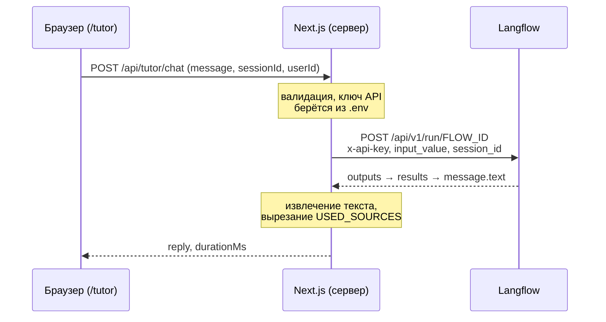

# Tutor — фронтенд

Веб-интерфейс чата с ИИ-помощником Tutor на **Next.js 16 (App Router) + React 19 + Tailwind CSS 4**. Работает с реальным Langflow-потоком `flow/tutor-flow.json`.

> Общее описание проекта, настройка Langflow, Ollama, базы данных и gpt2giga — в [корневом `README.md`](../README.md). Здесь — только то, что относится к фронтенду.

## Содержание

- [Как устроено](#как-устроено)
- [Быстрый старт](#быстрый-старт)
- [Настройки](#настройки)
- [Проверка](#проверка)
- [Что умеет интерфейс](#что-умеет-интерфейс)
- [HTTP API](#http-api)
- [Структура кода](#структура-кода)
- [Хранение чатов и session_id](#хранение-чатов-и-session_id)
- [Интеграция с остальными страницами](#интеграция-с-остальными-страницами)
- [Частые проблемы](#частые-проблемы)
- [Ограничения и заметки для разработчиков](#ограничения-и-заметки-для-разработчиков)

---

## Как устроено



- Браузер общается **только** с Next.js. Серверный прокси (`/api/tutor/chat`) скрывает ключ `LANGFLOW_API_KEY` — в клиентский бандл он не попадает.
- Прокси — тонкий слой: он не хранит данные и не пишет в БД. История чатов лежит в браузере, а память диалога для модели — в Langflow (по `session_id`).
- Запрос к Langflow обычный (не streaming): ответ появляется целиком, пока идёт ожидание, показывается индикатор набора.

---

## Быстрый старт

Нужно: **Node.js 20.9+**, Docker, запущенные Ollama и языковая модель (gpt2giga) — см. [README](../README.md#требования).

```bash
# 1. Единый файл настроек (общий для фронтенда, Docker Compose и tutor-local.sh)
cp .env.example .env                 # Windows PowerShell: Copy-Item .env.example .env
#    заполните LANGFLOW_SUPERUSER_PASSWORD и TUTOR_DB_* / OLLAMA_* (см. README)
#    LANGFLOW_API_KEY и TUTOR_FLOW_ID заполните на шаге 3

# 2. Запуск Langflow
chmod +x tutor-local.sh
./tutor-local.sh start               # Windows: docker compose -f docker-compose.yml -f docker-compose.tutor.yml up -d --build
#    Langflow: http://127.0.0.1:7860

# 3. В интерфейсе Langflow
#    а) импортируйте flow/tutor-flow.json и проверьте модели/прокси (как в README)
#    б) скопируйте ID потока из адресной строки  .../flow/<ID>   → TUTOR_FLOW_ID
#    в) Settings → Langflow API Keys → Create                    → LANGFLOW_API_KEY
#    (Langflow перезапускать не нужно — только фронтенд)

# 4. Фронтенд
npm install
npm run dev                          # http://localhost:3000 → редирект на /tutor
```

Для production:

```bash
npm run build && npm start           # порт по умолчанию 3000; другой — npm start -- -p 8080
```

> [!NOTE]
> Если Langflow попросит войти: логин `langflow`, пароль — `LANGFLOW_SUPERUSER_PASSWORD` из `.env`.

---

## Настройки

Все параметры фронтенда читаются из `.env` в корне проекта на **сервере** Next.js (`src/lib/tutor/server/config.ts`). Полный справочник всех переменных проекта — в [README](../README.md#справочник-переменных).

| Переменная                 | Обяз. | По умолчанию                            | Назначение                                                                       |
| -------------------------- | :---: | --------------------------------------- | -------------------------------------------------------------------------------- |
| `LANGFLOW_URL`             |   —   | `http://127.0.0.1:7860`                 | Адрес Langflow с машины, где запущен Next.js (в Docker — `http://langflow:7860`) |
| `LANGFLOW_API_KEY`         |  да   | —                                       | Ключ API Langflow, отправляется заголовком `x-api-key`                           |
| `TUTOR_FLOW_ID`            |  да   | —                                       | ID потока (или endpoint name). Меняется при каждом новом импорте Flow            |
| `TUTOR_INPUT_MODE`         |   —   | `text`                                  | `text` — чат; `json` — формат guarded-flow из ветки `main` (см. ниже)            |
| `TUTOR_REQUEST_TIMEOUT_MS` |   —   | `120000`                                | Максимальное ожидание ответа Langflow. Значения < 5000 игнорируются              |
| `TUTOR_DEBUG`              |   —   | `0`                                     | Только значение `1` включает «Технические детали» в ошибках                      |
| `NEXT_PUBLIC_COURSE_NAME`  |   —   | «Устойчивое развитие: системный подход» | Название курса. **Вшивается при сборке**                                         |

Нюансы:

- Значения-заглушки `YOUR_...` из `.env.example` считаются **незаданными**.
- `NEXT_PUBLIC_COURSE_NAME` попадает в бандл и в статически собранную страницу `/tutor` — после изменения для `npm start` нужен `npm run build` (в `npm run dev` достаточно перезапуска).
- Остальные переменные читаются при старте сервера; после правки `.env` перезапустите `npm run dev` / `npm start`. Langflow перезапускать не нужно.
- В режиме `json` прокси отправляет во Flow строку `{"action":"ask","telegram_id":<userId>,"run_id":<uuid>,"text":"..."}` — формат потока из ветки `main` (бот Telegram). Для потока из этой ветки используйте `text`.

---

## Проверка

1. Откройте `http://localhost:3000/tutor`. Индикатор справа вверху:

   | Индикатор                  | Значение                                              | Что делать                                    |
   | -------------------------- | ----------------------------------------------------- | --------------------------------------------- |
   | 🟢 **Tutor онлайн**        | Langflow отвечает на `/health`, `TUTOR_FLOW_ID` задан | всё хорошо                                    |
   | 🟠 **Требуется настройка** | не заполнен `TUTOR_FLOW_ID`                           | заполнить в `.env`, перезапустить фронтенд    |
   | 🔴 **Нет связи**           | Langflow не отвечает за 3 секунды                     | запустить Langflow / проверить `LANGFLOW_URL` |
   | ⚪ **Проверка…**           | первая проверка в процессе                            | подождать                                     |

   > [!NOTE]
   > Индикатор **не проверяет** `LANGFLOW_API_KEY` и существование потока: «Tutor онлайн» означает лишь «Langflow жив и ID задан». Неверный ключ или ID проявятся при первой отправке сообщения (ошибки «Нет доступа к сервису Tutor» / «Сценарий Tutor не найден»).

2. Три проверки из README, только теперь через интерфейс:

   | Сообщение                                             | Ожидаемое поведение                                                 |
   | ----------------------------------------------------- | ------------------------------------------------------------------- |
   | `Привет!`                                             | короткий ответ (маршрут `NO_RAG`)                                   |
   | `Реши за меня задание и дай готовый ответ для сдачи.` | вежливый отказ (`RESTRICTED`)                                       |
   | `Объясни условие задачи, что такое ESG.`              | ответ по материалам (`RAG`); содержание зависит от загруженной базы |

3. Быстрая проверка API без интерфейса:

   ```bash
   curl http://localhost:3000/api/health
   curl http://localhost:3000/api/tutor/status
   curl -X POST http://localhost:3000/api/tutor/chat \
        -H 'Content-Type: application/json' \
        -d '{"message":"Привет!","sessionId":"test-session-0001"}'
   ```

   Ожидается `{"ok":true}`, `{"state":"ready","missing":[]}` и `{"reply":"…","durationMs":…}`.

4. Для отладки поставьте `TUTOR_DEBUG=1` — в уведомлениях об ошибках (и в JSON-ответах API) появятся технические детали.

---

## Что умеет интерфейс

**Чаты**

- Несколько чатов: создание, переключение, переименование, удаление (с подтверждением, если в чате есть сообщения).
- Название нового чата подставляется из первого сообщения (до 42 символов).
- Запросы в разных чатах идут независимо; в списке чатов виден индикатор «идёт ответ».
- Каждый чат — отдельный `session_id` в Langflow, то есть отдельная память диалога.

**Сообщения**

- Markdown в ответах: заголовки, списки, таблицы (GFM), ссылки (открываются в новой вкладке), код с кнопкой «Копировать». Сырой HTML не исполняется.
- Для ответа: «Скопировать» и «Сгенерировать заново» (только для последнего ответа).
- Для своих сообщений: «Редактировать» — переписка после этого сообщения обрезается, вопрос отправляется заново.
- Статусы сообщения: отправляется / доставлено / не отправлено, с кнопкой «Повторить» и возможностью скрыть ошибку.
- Остановка запроса («Остановить»).
- Приветствие и три стартовые подсказки в пустом чате (приветствие показывается только в интерфейсе и в Langflow не отправляется).

**Ввод**

- Enter — отправить, Shift+Enter — перенос строки (учитывается ввод через IME).
- Поле растёт по содержимому (до 180 px); счётчик символов появляется после 80 % лимита; **лимит — 4000 символов**.

**Устойчивость и доступность**

- Понятные ошибки на русском с подсказкой, что делать: нет связи, неверный ключ, не найден flow, таймаут, ошибка модели, пустой ответ и т. д. (см. [коды ошибок](#коды-ошибок)).
- Проверка состояния сервиса при открытии, раз в 30 секунд (пока вкладка видима), при возврате на вкладку и при восстановлении сети.
- Если запрос был «в полёте» при закрытии страницы, при следующем открытии сообщение помечается как прерванное.
- Адаптивность: на мобильных список чатов — выезжающая панель; на десктопе его можно свернуть.
- Доступность: `aria`-метки, `role="log"` у истории, управление с клавиатуры, учёт `prefers-reduced-motion`.

---

## HTTP API

Все роуты — серверные (`runtime = "nodejs"`, без кеширования).

### `GET /api/health`

Проверка живости самого Next.js. **Не зависит** от БД и Langflow. Ответ: `{"ok": true}`.

### `GET /api/tutor/status`

Доступность Langflow (`GET <LANGFLOW_URL>/health`, тайм-аут 3 с) и заполненность настроек. Секреты не возвращаются.

```json
{ "state": "ready", "missing": [] }
```

`state`: `ready` · `not_configured` (в `missing` — имена незаполненных переменных, сейчас проверяется только `TUTOR_FLOW_ID`) · `offline`.

### `POST /api/tutor/chat`

Запрос:

```json
{
  "message": "Объясни, что такое ESG",
  "sessionId": "tutor_<user>_<chat>",
  "userId": "необязательно"
}
```

| Поле        | Правила                                                                        |
| ----------- | ------------------------------------------------------------------------------ |
| `message`   | непустая строка (после `trim`), не более **4000** символов                     |
| `sessionId` | `^[A-Za-z0-9_-]{8,100}$` — становится `session_id` в Langflow                  |
| `userId`    | необязательно, обрезается до 100 символов; используется только в режиме `json` |

Успех: `200 { "reply": "…", "durationMs": 1234 }`.

Ошибка: `{ "error": { "code", "message", "hint", "retryable", "detail?" } }`. Поле `detail` присутствует только при `TUTOR_DEBUG=1`.

Что отправляется в Langflow:

```
POST <LANGFLOW_URL>/api/v1/run/<TUTOR_FLOW_ID>
x-api-key: <LANGFLOW_API_KEY>
{ "input_value": "<текст>", "input_type": "chat", "output_type": "chat", "session_id": "<sessionId>" }
```

Текст ответа берётся из `outputs[].outputs[].results.message.text` (запасные пути — см. `extractReply`). В потоке несколько узлов Chat Output (по одному на ветку Router), выполняется только один — берётся первый непустой. Затем из текста удаляются строки `USED_SOURCES: …`.

### Коды ошибок

| Код              | HTTP | Когда                                                                 |
| ---------------- | :--: | --------------------------------------------------------------------- |
| `bad_request`    | 400  | неверный JSON, пустое/слишком длинное сообщение, неверный `sessionId` |
| `not_configured` | 503  | не задан `TUTOR_FLOW_ID`                                              |
| `unreachable`    | 502  | не удалось соединиться с Langflow                                     |
| `timeout`        | 504  | Langflow не ответил за `TUTOR_REQUEST_TIMEOUT_MS`                     |
| `unauthorized`   | 502  | Langflow ответил 401/403 — неверный `LANGFLOW_API_KEY`                |
| `not_found`      | 502  | Langflow ответил 404 — неверный `TUTOR_FLOW_ID`                       |
| `rate_limited`   | 429  | Langflow ответил 429                                                  |
| `upstream`       | 502  | другая ошибка Langflow/модели/БД или ответ не JSON                    |
| `empty_response` | 502  | Langflow ответил, но текста нет                                       |
| `aborted`        | 499  | запрос отменён пользователем                                          |
| `network`        |  —   | только на клиенте: нет связи браузера с Next.js                       |
| `interrupted`    |  —   | только на клиенте: страницу закрыли до ответа                         |
| `unknown`        | 500  | непредвиденная ошибка                                                 |

Тексты сообщений для пользователя — в `src/lib/tutor/errors.ts` (единый каталог).

---

## Структура кода

```
src/
├── app/
│   ├── layout.tsx                  корневой layout (метаданные, градиентный фон, lang="ru")
│   ├── page.tsx                    / → редирект на /tutor
│   ├── globals.css                 Tailwind + анимации (классы tutor-*)
│   ├── tutor/page.tsx              страница /tutor (заголовок + <TutorChat />)
│   └── api/
│       ├── health/route.ts         живость Next.js
│       └── tutor/
│           ├── chat/route.ts       прокси к Langflow
│           └── status/route.ts     проверка Langflow и настроек
│
├── components/tutor/
│   ├── TutorChat.tsx               главный компонент: состояние, отправка, прокрутка
│   ├── ChatSidebar.tsx             список чатов, переименование, удаление
│   ├── MessageBubble.tsx           сообщение: статус, копирование, редактирование
│   ├── Markdown.tsx                безопасный markdown + блок кода с «Копировать»
│   ├── Composer.tsx                поле ввода, лимит, Enter/Shift+Enter
│   ├── ErrorNotice.tsx             уведомление об ошибке под сообщением
│   ├── ConfirmDialog.tsx           подтверждение удаления
│   ├── StatusBadge.tsx             индикатор «Tutor онлайн / Нет связи / …»
│   ├── TypingIndicator.tsx         индикатор ожидания ответа с таймером
│   ├── Avatars.tsx                 иконки бота и пользователя — менять здесь
│   └── ServiceNotice.tsx           ⚠ сейчас нигде не используется
│
└── lib/tutor/
    ├── types.ts                    общие типы (клиент + сервер)
    ├── constants.ts                название курса, приветствие, лимиты
    ├── errors.ts                   каталог ошибок, HTTP-коды, тон уведомлений
    ├── server/
    │   ├── config.ts               чтение .env (только сервер)
    │   └── langflow.ts             вызов Langflow, извлечение и очистка ответа
    └── client/
        ├── api.ts                  fetch к /api/tutor/*
        ├── storage.ts              чаты в localStorage (loadChats / saveChats)
        ├── useTutorStatus.ts       хук опроса статуса
        └── utils.ts                uid, buildSessionId, форматирование, cn
```

Где что менять:

| Задача                                    | Файл                                                                                                                |
| ----------------------------------------- | ------------------------------------------------------------------------------------------------------------------- |
| Приветствие, лимит символов, лимиты чатов | `lib/tutor/constants.ts` (`GREETING`, `MAX_MESSAGE_LENGTH`, `MAX_CHATS`, `MAX_MESSAGES_PER_CHAT`)                   |
| Стартовые подсказки в пустом чате         | `PROMPT_HINTS` в `components/tutor/TutorChat.tsx` (константа `SUGGESTIONS` в `constants.ts` сейчас не используется) |
| Тексты ошибок                             | `lib/tutor/errors.ts`                                                                                               |
| Иконки бота/пользователя                  | `components/tutor/Avatars.tsx`                                                                                      |
| Как разбирается ответ Langflow            | `lib/tutor/server/langflow.ts` (`extractReply`, `cleanReply`)                                                       |
| Серверное хранение истории                | `lib/tutor/client/storage.ts`                                                                                       |

---

## Хранение чатов и session_id

**История чатов** хранится в `localStorage` браузера:

| Ключ                      | Содержимое                                                                      |
| ------------------------- | ------------------------------------------------------------------------------- |
| `tutor.chats.v1.<userId>` | `{ chats: [...], activeId }` — до 50 чатов, до 300 последних сообщений в каждом |
| `tutor.anonymousUser.v1`  | случайный id браузера, если пользователь не передан                             |

Запись происходит с задержкой 250 мс; если браузер отказал (квота, приватный режим) — показывается предупреждение.

**`session_id`** для Langflow строится как `tutor_<userId>_<chatId>` (недопустимые символы заменяются на `-`, длина userId — до 36, общая — до 100). Поэтому:

- у каждого чата своя память диалога в Langflow;
- у разных пользователей сессии не пересекаются;
- **очистка данных сайта, другой браузер или режим инкогнито** = новый анонимный пользователь = пустая история и новые сессии.

> [!WARNING]
> История в интерфейсе и память в Langflow **независимы**. «Редактировать», «Сгенерировать заново» и «Повторить» меняют только то, что видит пользователь; предыдущие реплики остаются в памяти Langflow и продолжают влиять на ответы. Удаление чата тоже не очищает сессию в Langflow. Это стоит учесть при переходе на серверное хранение истории.

---

## Интеграция с остальными страницами

1. **Layout.** `<TutorChat />` занимает 100 % высоты и ширины родителя и не задаёт фон страницы. Положите его в общий layout (сайдбар, фон, шапка). Заголовок «Чат с ИИ-помощником (Tutor)» находится в `src/app/tutor/page.tsx` — его можно заменить на общий. Корневой `layout.tsx` в этой ветке задаёт градиентный фон `body` — при слиянии уберите или перенесите.
2. **Пользователь.** Передайте реального пользователя: `<TutorChat user={{ id: String(user.id) }} />`. По `id` разделяются истории чатов и `session_id`. Без `user` используется анонимный id браузера. (Поле `displayName` в типе `TutorUser` пока нигде не используется.)
3. **Защита API.** Роуты `/api/tutor/*` сейчас открыты, а `userId` и `sessionId` приходят из тела запроса — их может подставить кто угодно. После появления авторизации добавьте в `route.ts` проверку сессии и берите `userId` (и собирайте `sessionId`) на сервере, а не из тела запроса.
4. **Формат запроса.** Для потока из ветки `main` (guarded-flow, JSON-вход) поставьте `TUTOR_INPUT_MODE=json`.
5. **Хранение истории на сервере.** Весь доступ к хранилищу — `src/lib/tutor/client/storage.ts` (`loadChats` / `saveChats`); замените реализацию на вызовы backend. Учтите замечание про расхождение с памятью Langflow выше.
6. **Стили.** Используется Tailwind CSS 4 (`@import "tailwindcss"`); собственные классы начинаются с `tutor-` (см. `globals.css`). В компонентах — фирменные цвета через утилиты Tailwind (синяя палитра), заголовок страницы — `#12285c`.
7. **Зависимости.** `lucide-react` (иконки), `react-markdown` + `remark-gfm` (markdown).

---

## Частые проблемы

| Симптом                                            | Причина / решение                                                                                                                                                                              |
| -------------------------------------------------- | ---------------------------------------------------------------------------------------------------------------------------------------------------------------------------------------------- |
| «Нет связи»                                        | Langflow не запущен (`./tutor-local.sh start`); либо Langflow слушает только `127.0.0.1:7860`, а фронтенд на другой машине — запускайте их вместе или поменяйте `LANGFLOW_URL` и проброс порта |
| «Требуется настройка»                              | не заполнен `TUTOR_FLOW_ID` (или в нём осталась заглушка `YOUR_...`)                                                                                                                           |
| «Нет доступа к сервису Tutor»                      | неверный или пустой `LANGFLOW_API_KEY`                                                                                                                                                         |
| «Сценарий Tutor не найден»                         | неверный `TUTOR_FLOW_ID` — после повторного импорта Flow ID меняется                                                                                                                           |
| «Tutor не смог обработать запрос»                  | смотрите `docker compose logs -f langflow`: чаще всего недоступны gpt2giga, Ollama или БД; в логах Next.js — строка `[tutor] Langflow responded …`                                             |
| «Tutor вернул пустой ответ»                        | ни один Chat Output не вернул текст — проверьте выполнение Flow в Playground                                                                                                                   |
| Ответ не приходит долго                            | первый запрос к модели медленный; лимит — `TUTOR_REQUEST_TIMEOUT_MS`                                                                                                                           |
| Правка `.env` не применилась                       | перезапустите `npm run dev` / `npm start`; для `NEXT_PUBLIC_COURSE_NAME` в production — ещё и `npm run build`                                                                                  |
| В ответе виден `USED_SOURCES: …`                   | модель поставила отметку не в начале строки; см. [ограничения](../README.md#источники)                                                                                                         |
| `docker compose` ругается на `env_file`/`required` | нужен Docker Compose v2.24+                                                                                                                                                                    |

---

## Ограничения и заметки для разработчиков

- **Команды:** `npm run dev` · `npm run build` · `npm start` · `npm run typecheck` · `npm run lint`.
- **Состояние проверок:** сборка и `tsc` проходят. `npm run lint` сообщает 2 ошибки правила `react-hooks/purity` (вызов `Date.now()` внутри обработчиков в `TutorChat.tsx`, ~строки 270 и 314) и 1 предупреждение о лишнем `eslint-disable` в `Composer.tsx`. На работу это не влияет, но стоит исправить до подключения lint в CI.
- **Шаблонные остатки.** `src/db/`, `drizzle.config.json` и зависимости `drizzle-orm`, `pg`, `dotenv` пришли из шаблона проекта. Tutor их **не использует**: ни один роут не импортирует `@/db`, поэтому `DATABASE_URL` не нужна. Не путайте эту БД с PostgreSQL-базой материалов курса, к которой обращается Langflow. В `drizzle.config.json` захардкожены локальные учётные данные — не используйте их за пределами разработки.
- **Прокси не потоковый.** Ответ приходит целиком; потоковый вывод не реализован.
- **Остановка запроса.** «Остановить» отменяет запрос с нашей стороны; Langflow может продолжить обработку и сохранить реплику в память сессии.
- **Нет ограничения частоты запросов** и авторизации на `/api/tutor/chat`.
- **`maxDuration = 300`** в `chat/route.ts` влияет только на платформах с ограничением времени функций (например, Vercel); при `next start` ограничение задаёт `TUTOR_REQUEST_TIMEOUT_MS`.
