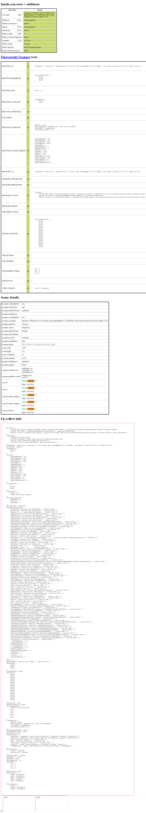

# Парсер учебных материалов

Парсер для сбора сырых данных с arXiv и Biblioclub. Перед парсингом Biblioclub требуется вход в аккаунт.

## Примеры полученных данных

- [arXiv](./parsed_data/arxiv_document_0.txt)
- [BiblioClub](./parsed_data/biblioclub_document_1.txt)

### Установка

1. Установите Python 3.14+.

2. Склонируйте репозиторий

    ```bash
    mkdir parser
    cd parser
    git clone --no-checkout --depth 1 https://github.com/InsomniaGlitch/proedu_2026-2027/ .
    git sparse-checkout init
    git sparse-checkout set "parser/*"
    git checkout database
    ```

### Быстрый старт

1. Откройте терминал в директории, содержащей файл `main.py`. Установите зависимости:

    ```bash
    pip install -r requirements.txt
    ```

2. Используйте команду:

    ```bash
    python main.py
    ```

### Проверка уровня скрытности


